<!-- Landing page in English: what Pawdori is, what it looks like, how to install and update it. The Spanish page is README.md. -->
<p align="center">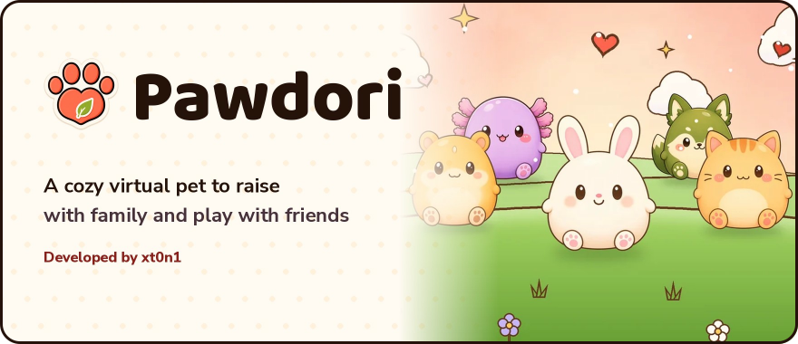</p>

<p align="center"><a href="README.md">Español</a> · <strong>English</strong></p>

<p align="center">
  <a href="https://github.com/xt0n1-t3ch/Pawdori-Game/releases/latest"></a>
  <a href="https://app.pawdori.black-watch.net"></a>
</p>
<p align="center">
  <a href="https://github.com/xt0n1-t3ch/Pawdori-Game/releases/latest"></a>
  <a href="https://github.com/xt0n1-t3ch/Pawdori-Game/releases"></a>
  
  
  
  
</p>

<h2 align="center" id="what-is-pawdori"></h2>

**Pawdori** is a virtual pet game for Android and the browser. You adopt a pet, feed it, bathe it, cuddle it and tuck it in for the night, and watch it grow day by day. You don't do it alone: your family and friends can care for it with you from their own phones, with a family chat and a log of who did what.

You also play: six mini games to play solo or as a challenge with friends, **You or Me?** and the live **Pet Race**. The coins you earn buy groceries at the supermarket, outfits for your pet and furniture for its room.

It is free, it speaks **English and Spanish**, and it is made for players **13 and up**: big buttons, few words and no fake urgency. Your progress lives in your account, so it is the same on another phone or in the browser.

<h2 align="center" id="showcase"></h2>

<p align="center">
<a href="assets/screenshots/en/desktop.webp">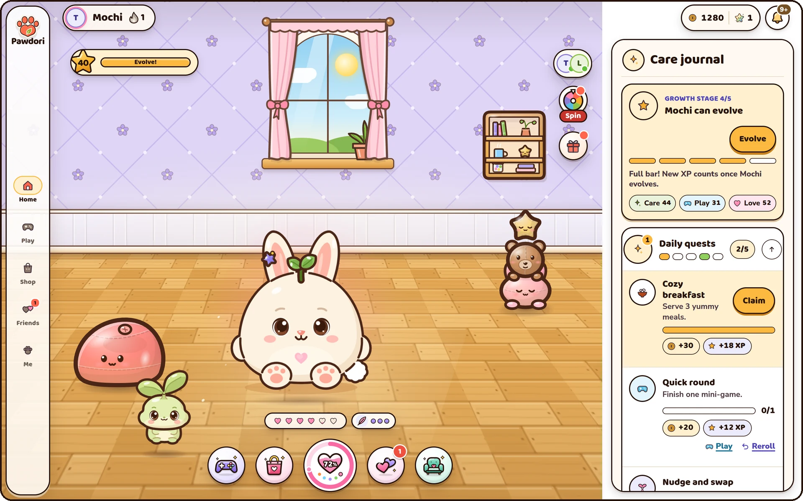</a>
<br><sub>Mochi's room on a large screen, with the care journal and today's quests beside it.</sub>
</p>

<table>
  <tr>
    <td width="33%" align="center"><a href="assets/screenshots/en/home.webp">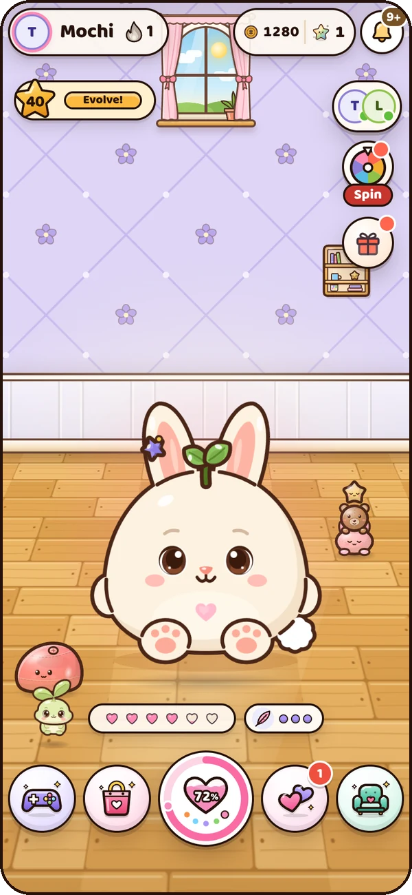</a><br><sub><b>Home.</b> Your pet in its room, everything one tap away.</sub></td>
    <td width="33%" align="center"><a href="assets/screenshots/en/pets.webp">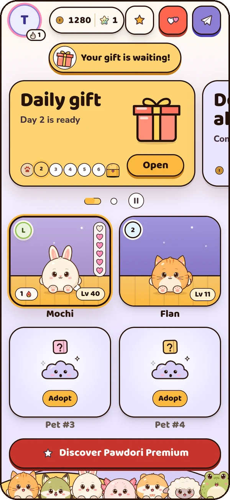</a><br><sub><b>Your pets.</b> Each with its own level, streak and room.</sub></td>
    <td width="33%" align="center"><a href="assets/screenshots/en/daily-gift.webp">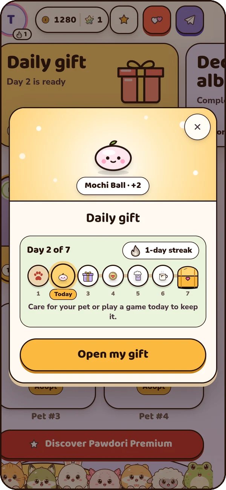</a><br><sub><b>Daily gift.</b> Seven days in a row, a prize for each.</sub></td>
  </tr>
  <tr>
    <td width="33%" align="center"><a href="assets/screenshots/en/games.webp">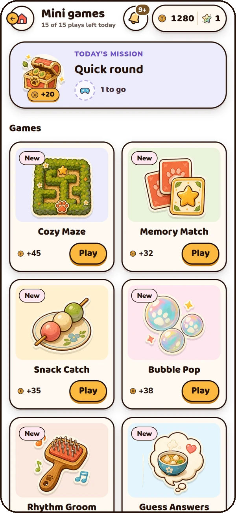</a><br><sub><b>Mini games.</b> Six games to play solo or as a challenge.</sub></td>
    <td width="33%" align="center"><a href="assets/screenshots/en/bubble-pop.webp">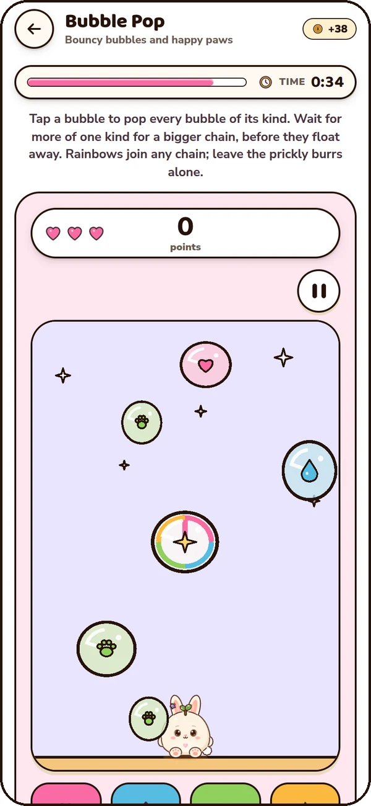</a><br><sub><b>Bubble Pop.</b> Chain bubbles of a kind before they float away.</sub></td>
    <td width="33%" align="center"><a href="assets/screenshots/en/shop.webp">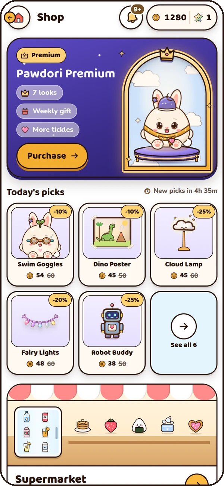</a><br><sub><b>Shop.</b> Daily deals, Premium and the supermarket.</sub></td>
  </tr>
  <tr>
    <td width="33%" align="center"><a href="assets/screenshots/en/wardrobe.webp">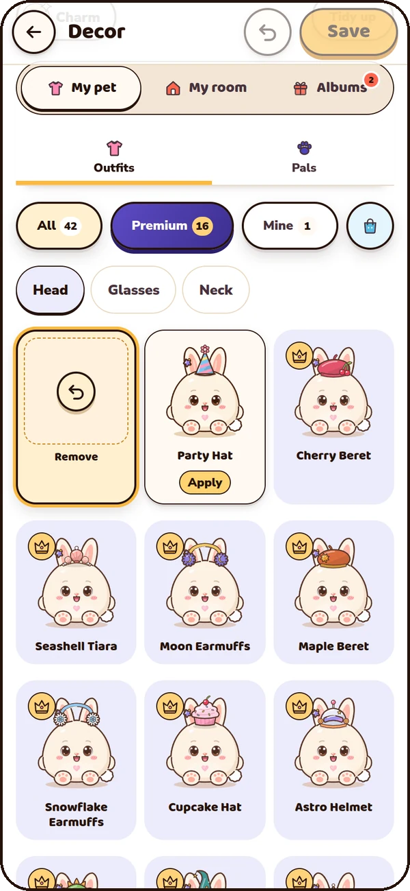</a><br><sub><b>Outfits and pals.</b> Dress your pet and decorate its room.</sub></td>
    <td width="33%" align="center"><a href="assets/screenshots/en/family.webp">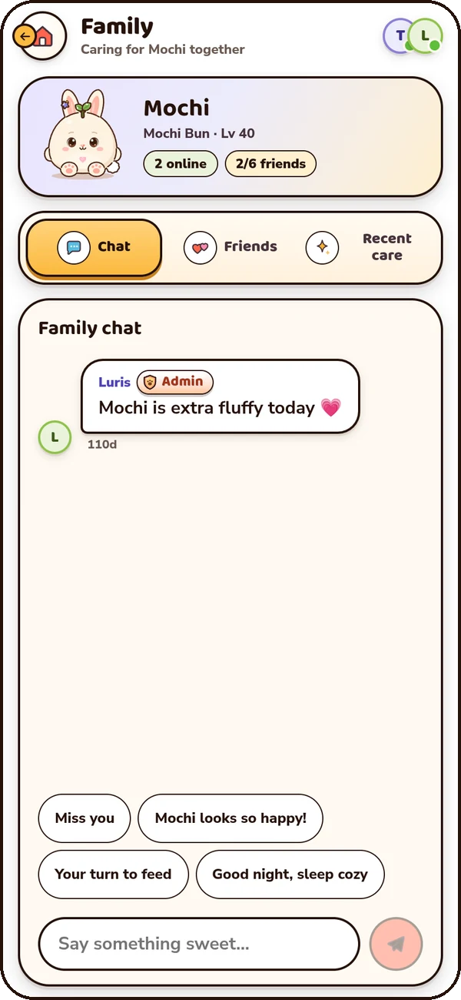</a><br><sub><b>Family.</b> Care for it together and chat about it.</sub></td>
    <td width="33%" align="center"><a href="assets/screenshots/en/sign-in.webp">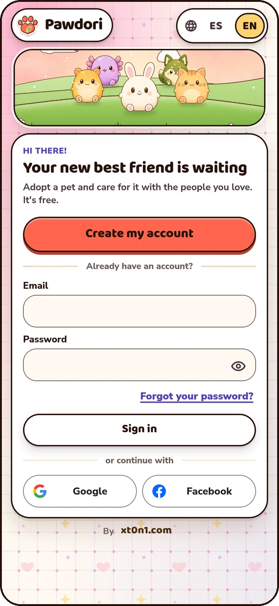</a><br><sub><b>Your account.</b> Free to create, in your language.</sub></td>
  </tr>
</table>

<p align="center"><sub>Pawdori 3.1.0 in the game's simulation, on a 412 px phone and a 1440 px screen.</sub></p>

<h2 align="center" id="features"></h2>

| | What you can do |
| --- | --- |
| 🐾 **Pets** | 14 species: Mochi Bun, Puddin Cat, Nori Fox, Bubble Axolotl, Maple Bear, Pebble Penguin, Taro Panda, Honey Hamster, Sprout Frog, Cloud Sheep, Cocoa Otter, Starlight Dragon, Biscuit Pup and Pepper Pup. Each has its own personality, traits and five stages to grow and evolve through. |
| 💛 **Care** | Food, water, baths, rest and love. Every care shows what it gave ("Food +35", "+10 XP"), and your pet tells you when something isn't needed. Tickle it to shake out treats. |
| 🌙 **Day and night** | Your pet falls asleep, rests and wakes up with a big stretch and a "Good morning!". |
| 🏡 **Family** | Up to six people care for the same pet, each on their own phone, with a family chat and a care log. |
| 🤝 **Friends** | Friend requests, profiles and messages, private by default. Messages are moderated before anyone sees them. |
| 🎮 **Mini games** | Cozy Maze, Memory Match, Snack Catch, Bubble Pop, Rhythm Groom and Guess Answers, solo or as challenges. Plus **You or Me?** with a friend and the live **Pet Race**. Friends and global leaderboards. |
| 🎁 **Daily rewards** | A seven-day daily gift with a streak, the daily wheel, daily quests and achievements. |
| 🛍️ **Shop** | Daily deals, a supermarket with meals, drinks and soaps for the pantry, and Pawdori Premium with clear prices. |
| 🎀 **Outfits and decor** | Hats, glasses and scarves for your pet, little pals to keep it company, and furniture, walls and floors for its room. Complete deco albums for rewards. |
| 🌐 **Two languages** | English and Spanish. Pawdori follows your phone's language, and you can switch any time. |
| 📲 **One account** | The same game on Android and in the browser. |

<h2 align="center" id="requirements"></h2>

| | |
| --- | --- |
| System | Android 10 or newer |
| Space | About 28 MB to download the APK |
| Internet | Yes: your pet, coins and rewards live on the server |
| Account | An email address; accounts are free |
| Browser | Chrome 111 or newer, or Safari 16.4 or newer, to play without installing anything |

<h2 align="center" id="installation"></h2>

<p align="center">
  <a href="https://github.com/xt0n1-t3ch/Pawdori-Game/releases/latest"></a>
</p>

<p align="center">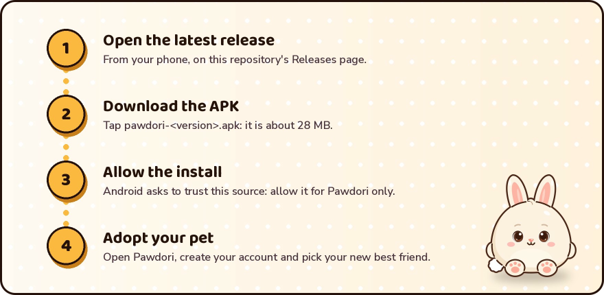</p>

1. From your phone, open the [**latest release**](https://github.com/xt0n1-t3ch/Pawdori-Game/releases/latest).
2. Under **Assets**, tap `pawdori-<version>.apk` to download it.
3. Open it. Android asks to allow installs from this source: allow it for Pawdori only.
4. Open Pawdori, create your account and adopt your pet.

<details>
<summary>No Android? Play in your browser</summary>

Open [**app.pawdori.black-watch.net**](https://app.pawdori.black-watch.net) in Chrome, Edge or Safari and sign in. It is the same game as on Android. From the browser's menu you can **install** it as an app (PWA) and open it from your home screen, on iPhone and iPad too.

</details>

<h2 align="center" id="updates"></h2>

When a new version is out, Pawdori shows a small window with what's new, in your language, and an **Update** button. The app downloads the new APK, checks that its hash and signature are the official ones, and opens Android's installer for you to confirm. Your progress is not touched.

Some versions are required, for example when the server changes: the app asks you to update before you keep playing.

To do it by hand, download the new APK from the [latest release](https://github.com/xt0n1-t3ch/Pawdori-Game/releases/latest) and install it over the old one. Every version's notes, in English and Spanish, are on [Releases](https://github.com/xt0n1-t3ch/Pawdori-Game/releases).

<h2 align="center" id="security"></h2>

- Every APK is **signed** with Pawdori's official key. Android won't install a copy signed by someone else over it, and the app refuses an update with another signature.
- Every version comes with its **SHA-256** in `pawdori-<version>.apk.sha256` and in `latest.json`, and the app checks it before installing.
- Your coins, rewards, inventory and progress live on the **server**: they can't be changed from the phone, and they aren't lost when you change phones.
- Chat messages are **moderated** before anyone sees them. If moderation doesn't answer, the message waits; it is never published unchecked.

<details>
<summary>Check the APK yourself</summary>

The SHA-256 fingerprint of Pawdori's signing certificate (package `com.pawdori.app`) is:

```text
BA:93:A4:A1:CA:42:94:70:86:81:B2:AD:BB:02:7E:4B:27:90:F7:D1:E2:6D:FA:48:E6:FB:24:66:B0:66:D0:92
```

It is the same one Pawdori's site publishes in [`assetlinks.json`](https://pawdori.black-watch.net/.well-known/assetlinks.json). To check a download on your computer:

```bash
sha256sum -c pawdori-3.1.0.apk.sha256            # pawdori-3.1.0.apk: OK
apksigner verify --print-certs pawdori-3.1.0.apk  # the SHA-256 digest must match the one above
```

</details>

<h2 align="center" id="releases"></h2>

Every version on [Releases](https://github.com/xt0n1-t3ch/Pawdori-Game/releases) has its notes in English and Spanish and three files:

| File | What it is for |
| --- | --- |
| `pawdori-<version>.apk` | The Android installer |
| `pawdori-<version>.apk.sha256` | The APK's hash, to check the download |
| `latest.json` | What the app reads to find a new version: the number, notes in English and Spanish, size and hash |

Pawdori follows [Semantic Versioning](https://semver.org/): the first number changes with big updates, the second with new features and the third with fixes.

<h2 align="center" id="faq"></h2>

### Is Pawdori free?

Yes, the whole game is free. **Pawdori Premium** is optional: members' outfits and wallpapers, a weekly gift, more tickles and an extra wheel spin, with the price and renewal in plain sight and a clear way to say no. There are no paid random rewards.

### Why isn't it on Google Play?

For now Pawdori installs from here and updates itself. The Google Play version comes later; that one will update from the store.

### Is installing an APK safe?

Install only the APK from this repository. It is signed with the official key and comes with its SHA-256 hash, which the app and you can check (see [Security](#security)). Afterwards you can take back your browser's permission to install apps.

### Do I lose my pet if I change phones?

No. Your pet and your progress are in your account. Install Pawdori on the new phone, or open the browser, and sign in with your email.

### Does it work on iPhone?

There is no iPhone app yet, but you can play in the browser at [app.pawdori.black-watch.net](https://app.pawdori.black-watch.net) with Safari 16.4 or newer, and add it to your home screen.

### Can my family care for the same pet?

Yes. Share your family's invite code: up to six people care for the same pet, each on their own phone, and everyone sees changes right away.

### Are there ads?

Ads are family-safe and not personalized, and the ones that give a reward are always optional. Premium, or the one-time Remove Ads purchase, removes the rest.

### What age is it for?

Players 13 and up.

<h2 align="center" id="this-repository"></h2>

This repository publishes Pawdori's installers and this page. The game's code lives in a private repository; the APKs are published on [Releases](https://github.com/xt0n1-t3ch/Pawdori-Game/releases), not in the git history.

```text
README.md            the page in Spanish
README.en.md         this page, in English
llms.txt             a map of Pawdori for language models (llms-full.txt: all of the text)
CITATION.cff         how to cite Pawdori (GitHub's "Cite this repository")
assets/readme/       the cover, headings and steps, in es/ and en/, and the social preview
assets/screenshots/  the game's screenshots, in es/ and en/
scripts/make_art.py  draws this page's pictures with Pawdori's own art and fonts
scripts/llms.py      writes llms.txt and llms-full.txt from both pages
```

<details>
<summary>Regenerating the pictures and the language model files</summary>

```bash
python3 -I scripts/make_art.py --source /path/to/Pawdori --shots /path/to/captures
python3 -I scripts/llms.py            # writes llms.txt and llms-full.txt
python3 -I scripts/llms.py --check    # fails when they are out of date
```

`make_art.py` reads the Baloo 2 and Nunito Sans fonts and the game's art from a Pawdori checkout, and the captures from the game's simulation at 2x (one `es/` and one `en/` folder). It checks that the text in every picture reaches a contrast of 7:1 or more.

</details>

<h2 align="center" id="credits"></h2>

Pawdori is made by [xt0n1](https://github.com/xt0n1-t3ch) (XT0N1.T3CH). The game, its art, its characters and this page are © 2026 xt0n1, all rights reserved: you may download and install Pawdori and share a link to this page, but not republish the APK or the art as your own.

The [Baloo 2](https://github.com/EkType/Baloo2) and [Nunito Sans](https://github.com/googlefonts/NunitoSans) fonts are used under the SIL Open Font License 1.1. The privacy policy is at [pawdori.black-watch.net/privacy](https://pawdori.black-watch.net/privacy).

---

<div align="center">
  <sub>Every day, a tiny new story with you. Made with love by <strong>XT0N1.T3CH</strong> 🐾</sub>
</div>
