<!-- Página principal en español: qué es Pawdori, cómo se ve, cómo se instala y se actualiza. La versión en inglés es README.en.md. -->
<p align="center">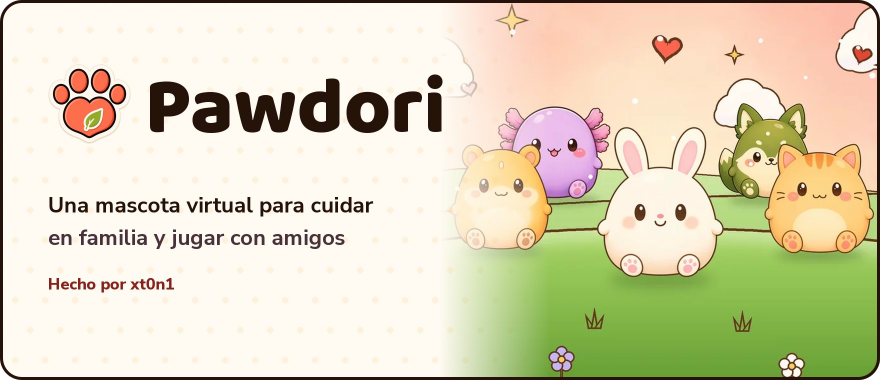</p>

<p align="center"><strong>Español</strong> · <a href="README.en.md">English</a></p>

<p align="center">
  <a href="https://github.com/xt0n1-t3ch/Pawdori-Game/releases/latest"></a>
  <a href="https://app.pawdori.black-watch.net"></a>
</p>
<p align="center">
  <a href="https://github.com/xt0n1-t3ch/Pawdori-Game/releases/latest"></a>
  <a href="https://github.com/xt0n1-t3ch/Pawdori-Game/releases"></a>
  
  
  
  
</p>

<h2 align="center" id="que-es-pawdori"></h2>

**Pawdori** es un juego de mascota virtual para Android y el navegador. Adoptas una mascota, le das de comer, la bañas, la mimas y la acuestas a dormir, y la ves crecer día a día. No la cuidas solo: tu familia y tus amigos pueden cuidarla contigo desde sus propios teléfonos, con un chat de familia y un historial de quién hizo qué.

También juegas: seis minijuegos para jugar solo o retar a tus amigos, **¿Tú o yo?** y la **Carrera de mascotas** en vivo. Con las monedas que ganas compras comida en el supermercado, ropa para tu mascota y muebles para decorar su cuarto.

Es gratis, está en **español e inglés** y está pensado para jugadores de **13 años o más**: botones grandes, pocas palabras y nada de urgencia falsa. Tu progreso vive en tu cuenta, así que lo encuentras igual en otro teléfono o en el navegador.

<h2 align="center" id="asi-se-ve"></h2>

<p align="center">
<a href="assets/screenshots/es/desktop.webp">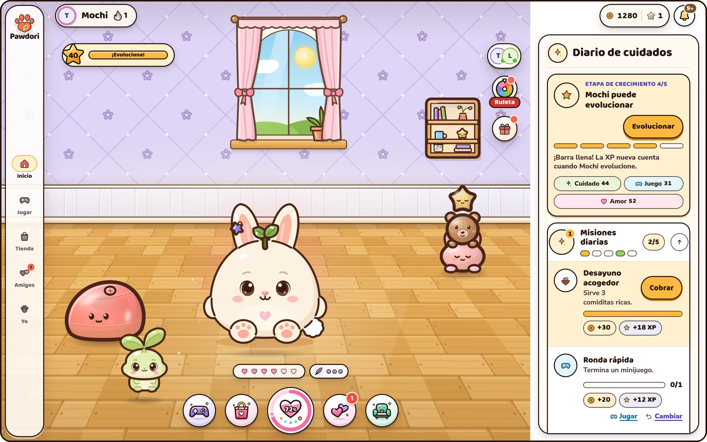</a>
<br><sub>El cuarto de Mochi en una pantalla grande, con el diario de cuidados y las misiones del día al lado.</sub>
</p>

<table>
  <tr>
    <td width="33%" align="center"><a href="assets/screenshots/es/home.webp"></a><br><sub><b>Inicio.</b> Tu mascota en su cuarto, con todo a un toque.</sub></td>
    <td width="33%" align="center"><a href="assets/screenshots/es/pets.webp">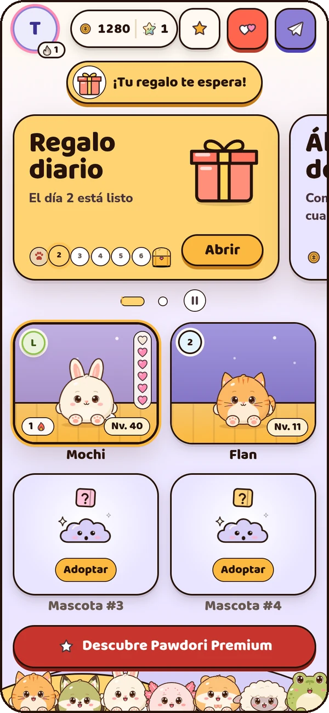</a><br><sub><b>Tus mascotas.</b> Cada una con su nivel, su racha y su cuarto.</sub></td>
    <td width="33%" align="center"><a href="assets/screenshots/es/daily-gift.webp">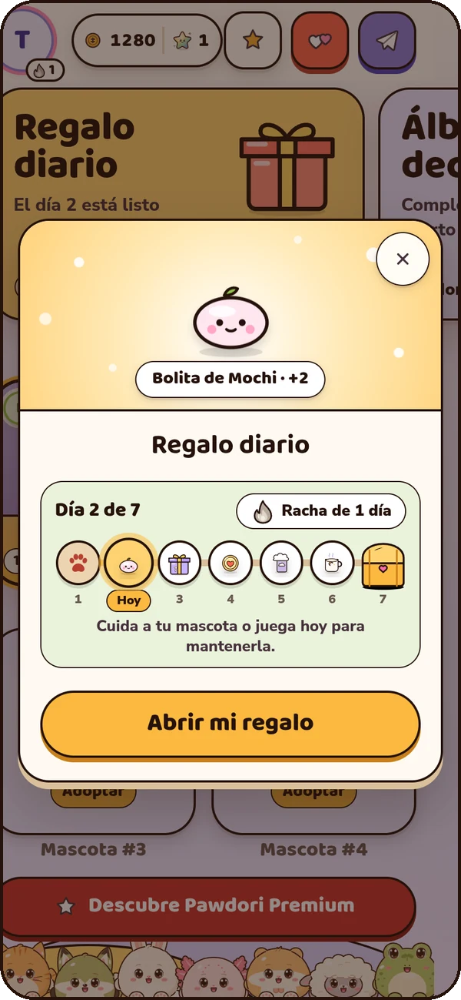</a><br><sub><b>Regalo diario.</b> Siete días seguidos, cada uno con su premio.</sub></td>
  </tr>
  <tr>
    <td width="33%" align="center"><a href="assets/screenshots/es/games.webp">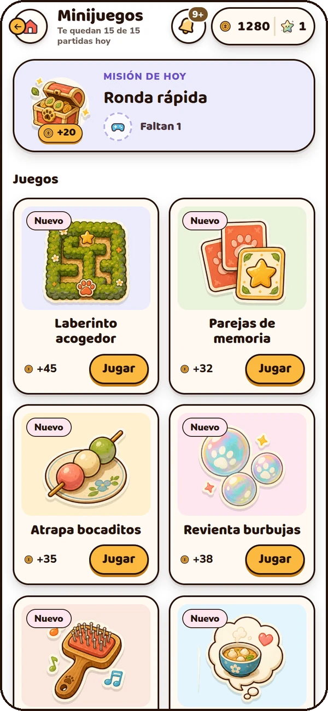</a><br><sub><b>Minijuegos.</b> Seis juegos para jugar solo o retar a un amigo.</sub></td>
    <td width="33%" align="center"><a href="assets/screenshots/es/bubble-pop.webp">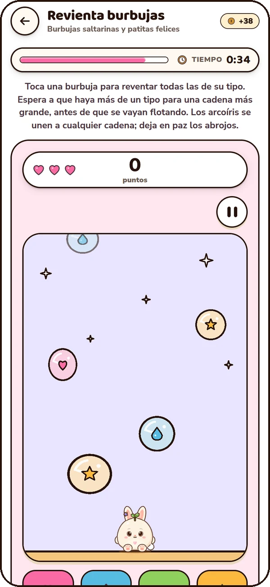</a><br><sub><b>Revienta burbujas.</b> Junta cadenas del mismo tipo antes de que se vayan.</sub></td>
    <td width="33%" align="center"><a href="assets/screenshots/es/shop.webp">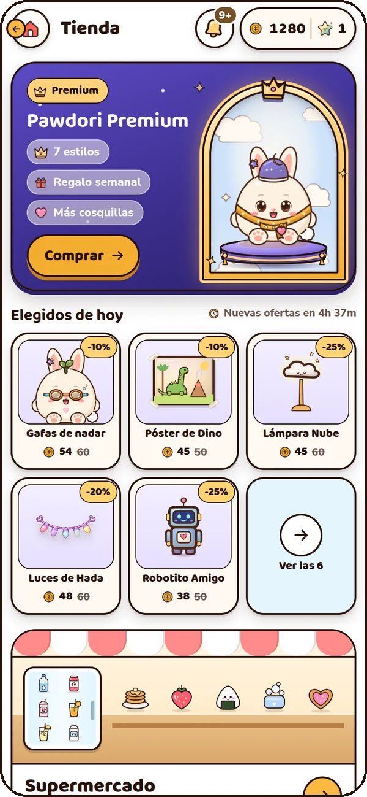</a><br><sub><b>Tienda.</b> Ofertas del día, Premium y el supermercado.</sub></td>
  </tr>
  <tr>
    <td width="33%" align="center"><a href="assets/screenshots/es/wardrobe.webp">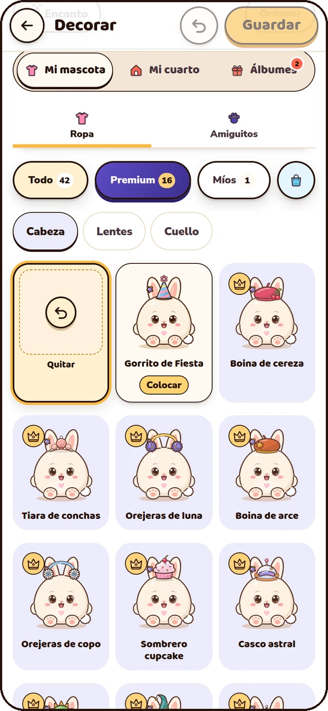</a><br><sub><b>Ropa y amiguitos.</b> Viste a tu mascota y decora su cuarto.</sub></td>
    <td width="33%" align="center"><a href="assets/screenshots/es/family.webp">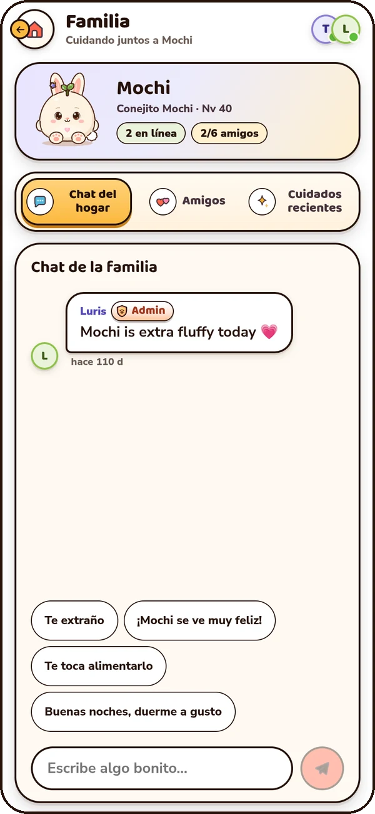</a><br><sub><b>Familia.</b> Cuídenla juntos y platiquen en su chat.</sub></td>
    <td width="33%" align="center"><a href="assets/screenshots/es/sign-in.webp">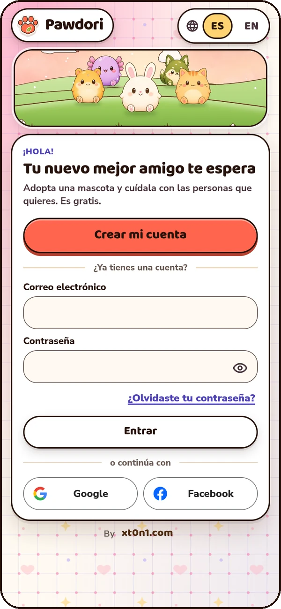</a><br><sub><b>Tu cuenta.</b> Crea tu cuenta gratis y elige tu idioma.</sub></td>
  </tr>
</table>

<p align="center"><sub>Capturas de Pawdori 3.1.0 en la simulación del juego, en un teléfono de 412 px y una pantalla de 1440 px.</sub></p>

<h2 align="center" id="que-hay-adentro"></h2>

| | Qué puedes hacer |
| --- | --- |
| 🐾 **Mascotas** | 14 especies: Conejito Mochi, Gatito Pudín, Zorrito Nori, Ajolote Burbuja, Osito Arce, Pingüino Guijarro, Panda Taro, Hámster Miel, Ranita Brote, Ovejita Nube, Nutria Cacao, Dragón Estelar, Cachorro Galleta y Cachorro Pimienta. Cada una tiene su carácter, sus rasgos y cinco etapas para crecer y evolucionar. |
| 💛 **Cuidados** | Comida, agua, baño, descanso y cariño. Cada cuidado te muestra lo que dio ("Comida +35", "+10 XP") y tu mascota te avisa cuando algo no hace falta. Hazle cosquillas para que suelte premios. |
| 🌙 **Día y noche** | Tu mascota se duerme, descansa y despierta con un gran estirón y un "¡Buenos días!". |
| 🏡 **Familia** | Hasta seis personas cuidan a la misma mascota, cada quien desde su teléfono, con un chat de familia y el historial de cuidados. |
| 🤝 **Amigos** | Solicitudes de amistad, perfiles y mensajes, privados por defecto. Los mensajes pasan por moderación antes de mostrarse. |
| 🎮 **Minijuegos** | Laberinto acogedor, Parejas de memoria, Atrapa bocaditos, Revienta burbujas, Ritmo de cepillado y Adivina respuestas, solos o como reto. Además **¿Tú o yo?** con un amigo y la **Carrera de mascotas** en vivo. Tablas de amigos y de todos. |
| 🎁 **Premios diarios** | Un regalo diario de siete días con racha, la ruleta diaria, misiones del día y logros. |
| 🛍️ **Tienda** | Ofertas del día, un supermercado con comidas, bebidas y jabones para la alacena, y Pawdori Premium con precios claros. |
| 🎀 **Ropa y decoración** | Gorritos, lentes y bufandas para tu mascota, amiguitos que la acompañan, y muebles, paredes y pisos para su cuarto. Completa los álbumes de decoración para ganar premios. |
| 🌐 **Dos idiomas** | Español e inglés. Pawdori sigue el idioma de tu teléfono y lo cambias cuando quieras. |
| 📲 **Una sola cuenta** | La misma partida en Android y en el navegador. |

<h2 align="center" id="requisitos"></h2>

| | |
| --- | --- |
| Sistema | Android 10 o más |
| Espacio | Unos 28 MB para descargar el APK |
| Internet | Sí: tu mascota, tus monedas y tus premios viven en el servidor |
| Cuenta | Un correo electrónico; la cuenta es gratis |
| Navegador | Chrome 111 o más, o Safari 16.4 o más, para jugar sin instalar nada |

<h2 align="center" id="instalacion"></h2>

<p align="center">
  <a href="https://github.com/xt0n1-t3ch/Pawdori-Game/releases/latest"></a>
</p>

<p align="center">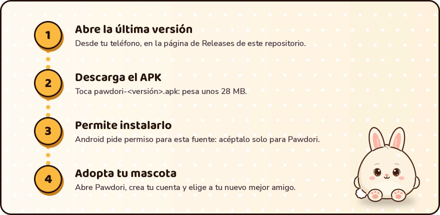</p>

1. Desde tu teléfono, abre la [**última versión**](https://github.com/xt0n1-t3ch/Pawdori-Game/releases/latest).
2. En **Assets**, toca `pawdori-<versión>.apk` para descargarlo.
3. Ábrelo. Android te pedirá permiso para instalar apps de esta fuente: acéptalo solo para Pawdori.
4. Abre Pawdori, crea tu cuenta y adopta tu mascota.

<details>
<summary>¿Sin Android? Juega en el navegador</summary>

Abre [**app.pawdori.black-watch.net**](https://app.pawdori.black-watch.net) en Chrome, Edge o Safari y entra con tu cuenta. Es la misma partida que en Android. Desde el menú del navegador puedes **instalarla** como app (PWA) para abrirla desde tu pantalla de inicio, también en iPhone y iPad.

</details>

<h2 align="center" id="actualizaciones"></h2>

Cuando sale una versión nueva, Pawdori te muestra una ventanita con las novedades en tu idioma y un botón **Actualizar**. La app descarga el APK nuevo, revisa que su huella y su firma sean las oficiales, y abre el instalador de Android para que confirmes. Tu progreso no se toca.

Algunas versiones son obligatorias, por ejemplo cuando cambia el servidor: la app te pide actualizar antes de seguir jugando.

Si prefieres hacerlo a mano, descarga el APK nuevo desde la [última versión](https://github.com/xt0n1-t3ch/Pawdori-Game/releases/latest) e instálalo encima. Las notas de cada versión, en español e inglés, están en [Releases](https://github.com/xt0n1-t3ch/Pawdori-Game/releases).

<h2 align="center" id="seguridad"></h2>

- Cada APK va **firmado** con la llave oficial de Pawdori. Android no deja instalar encima una copia firmada por otra persona, y la app no acepta una actualización con otra firma.
- Cada versión trae su **SHA-256** en `pawdori-<versión>.apk.sha256` y en `latest.json`, y la app lo comprueba antes de instalar.
- Tus monedas, premios, inventario y progreso viven en el **servidor**: no se pueden cambiar desde el teléfono y no se pierden si cambias de teléfono.
- Los mensajes del chat pasan por **moderación** antes de mostrarse. Si la moderación no responde, el mensaje espera; nunca se publica sin revisar.

<details>
<summary>Comprobar el APK tú mismo</summary>

La huella SHA-256 del certificado de firma de Pawdori (paquete `com.pawdori.app`) es:

```text
BA:93:A4:A1:CA:42:94:70:86:81:B2:AD:BB:02:7E:4B:27:90:F7:D1:E2:6D:FA:48:E6:FB:24:66:B0:66:D0:92
```

Es la misma que publica [`assetlinks.json`](https://pawdori.black-watch.net/.well-known/assetlinks.json) en el sitio de Pawdori. Para comprobar una descarga en tu computadora:

```bash
sha256sum -c pawdori-3.1.0.apk.sha256            # pawdori-3.1.0.apk: OK
apksigner verify --print-certs pawdori-3.1.0.apk  # la huella SHA-256 debe ser la de arriba
```

</details>

<h2 align="center" id="versiones"></h2>

Cada versión en [Releases](https://github.com/xt0n1-t3ch/Pawdori-Game/releases) trae sus notas en español e inglés y tres archivos:

| Archivo | Para qué |
| --- | --- |
| `pawdori-<versión>.apk` | El instalador para Android |
| `pawdori-<versión>.apk.sha256` | La huella del APK, para comprobar la descarga |
| `latest.json` | Lo que lee la app para saber si hay versión nueva: número, notas en español e inglés, tamaño y huella |

Pawdori sigue [Semantic Versioning](https://semver.org/lang/es/): el primer número cambia con las actualizaciones grandes, el segundo con las novedades y el tercero con los arreglos.

<h2 align="center" id="preguntas-frecuentes"></h2>

### ¿Pawdori es gratis?

Sí, todo el juego es gratis. **Pawdori Premium** es opcional: trae ropa y fondos de miembro, un regalo semanal, más cosquillas y otra vuelta en la ruleta, con el precio y la renovación a la vista y una forma clara de decir que no. No hay premios al azar que se compren con dinero.

### ¿Por qué no está en Google Play?

Por ahora Pawdori se instala desde aquí y se actualiza solo. La versión de Google Play llegará más adelante; esa se actualizará desde la tienda.

### ¿Es seguro instalar un APK?

Instala solo el APK de este repositorio. Va firmado con la llave oficial y trae su huella SHA-256, que la app y tú pueden comprobar (mira [Seguridad](#seguridad)). Al terminar puedes quitarle a tu navegador el permiso de instalar apps.

### ¿Pierdo mi mascota si cambio de teléfono?

No. Tu mascota y tu progreso están en tu cuenta. Instala Pawdori en el teléfono nuevo, o abre el navegador, y entra con tu correo.

### ¿Funciona en iPhone?

Todavía no hay app para iPhone, pero puedes jugar en el navegador en [app.pawdori.black-watch.net](https://app.pawdori.black-watch.net) con Safari 16.4 o más, e instalarla en tu pantalla de inicio.

### ¿Puedo cuidar la mascota con mi familia?

Sí. Comparte el código de invitación de tu familia: hasta seis personas cuidan a la misma mascota, cada quien desde su teléfono, y todos ven los cambios al momento.

### ¿Tiene anuncios?

Los anuncios son aptos para toda la familia y no personalizados, y los que dan premio siempre son opcionales. Premium, o la compra única de Quitar anuncios, quita los demás.

### ¿Para qué edad es?

Para jugadores de 13 años o más.

<h2 align="center" id="este-repositorio"></h2>

Este repositorio publica los instaladores de Pawdori y esta página. El código del juego vive en un repositorio privado; los APK se publican en [Releases](https://github.com/xt0n1-t3ch/Pawdori-Game/releases), no en el historial de git.

```text
README.md            esta página, en español
README.en.md         la misma página, en inglés
llms.txt             un mapa de Pawdori para modelos de lenguaje (llms-full.txt: todo el texto)
CITATION.cff         cómo citar Pawdori (el botón "Cite this repository" de GitHub)
assets/readme/       la portada, los encabezados y los pasos, en es/ y en/, y la vista previa social
assets/screenshots/  las capturas del juego, en es/ y en/
scripts/make_art.py  dibuja las imágenes de esta página con el arte y las fuentes de Pawdori
scripts/llms.py      escribe llms.txt y llms-full.txt a partir de las dos páginas
```

<details>
<summary>Volver a generar las imágenes y los archivos para modelos</summary>

```bash
python3 -I scripts/make_art.py --source /ruta/a/Pawdori --shots /ruta/a/capturas
python3 -I scripts/llms.py            # escribe llms.txt y llms-full.txt
python3 -I scripts/llms.py --check    # falla si están desactualizados
```

`make_art.py` lee las fuentes Baloo 2 y Nunito Sans y el arte del juego desde una copia de Pawdori, y las capturas desde la simulación del juego a 2x (una carpeta `es/` y otra `en/`). Revisa que el texto de cada imagen tenga un contraste de 7:1 o más.

</details>

<h2 align="center" id="creditos"></h2>

Pawdori lo hace [xt0n1](https://github.com/xt0n1-t3ch) (XT0N1.T3CH). El juego, su arte, sus personajes y esta página son © 2026 xt0n1, todos los derechos reservados: puedes descargar e instalar Pawdori y compartir el enlace a esta página, pero no volver a publicar el APK ni el arte como si fueran tuyos.

Las fuentes [Baloo 2](https://github.com/EkType/Baloo2) y [Nunito Sans](https://github.com/googlefonts/NunitoSans) se usan bajo la SIL Open Font License 1.1. La política de privacidad está en [pawdori.black-watch.net/privacy](https://pawdori.black-watch.net/privacy).

---

<div align="center">
  <sub>Cada día, una nueva historia pequeñita contigo. Hecho con cariño por <strong>XT0N1.T3CH</strong> 🐾</sub>
</div>
